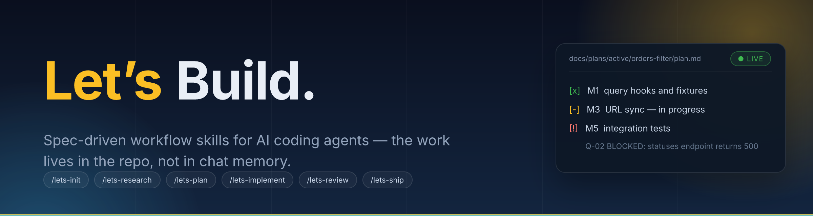
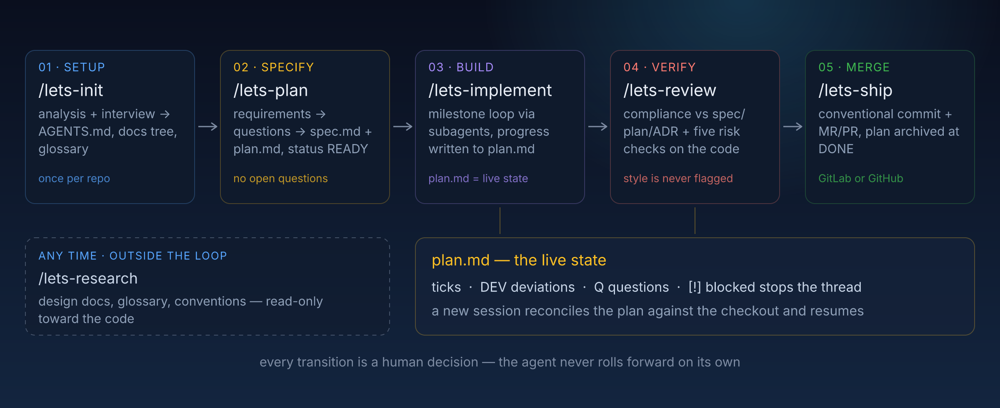
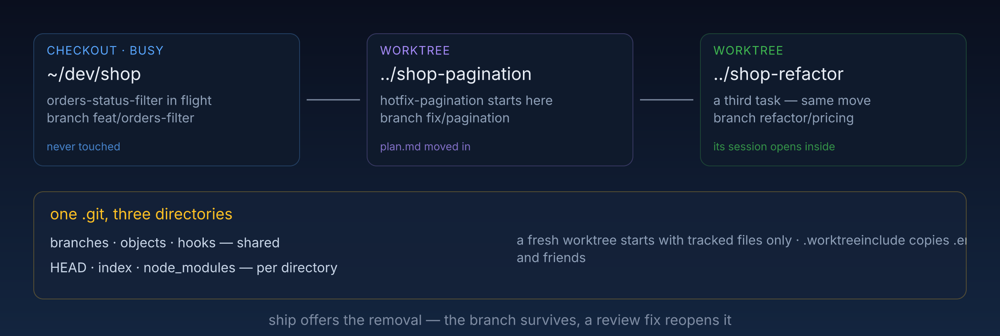

  

Engineering workflow skills for AI coding agents. Tasks run through living documents — spec, plan, ADR, RFC, design — stored in the repository itself. A new session resumes from the repo, not from chat memory.

Six public skills: init, research, plan, implement, review, ship. Four service skills carry the shared machinery.

## Install

    npx skills add seropaski/lets-build

Run `/lets-init` once in the target repository: it analyzes the project, interviews you, and creates the AGENTS.md and docs/ tree every other skill reads. If docs/ is already yours, `/lets-init --docs-dir lets-docs` puts the tree under another folder — init asks on its own when it finds a docs/ with your files in it, and the folder lands in AGENTS.md, so every skill reads it from there. You need git and an agent that supports skills and subagents. An agent that reads CLAUDE.md rather than AGENTS.md gets a one-line CLAUDE.md that imports it.

## The workflow

  

Every transition is a human decision: the agent never rolls from planning into coding, or from coding into committing. plan.md stays the live state — ticks, deviations, blockers — so any session continues where the last one stopped:

    ## Milestones
    - [x] M1 Query hooks and fixtures
    - [-] M3 URL sync
    - [!] M5 Integration tests    Q-02 BLOCKED: statuses endpoint returns 500

## What the repository gains

    AGENTS.md                       how the agent works in this repo
    docs/
      glossary/                     the domain model, one file per domain
      conventions/                  per-area rules; _index.md maps paths to rules
      design/                       what the system does today, one file per area
      architecture/                 ADRs accepted, RFCs under discussion
      plans/active/<id>-<slug>/     spec.md + plan.md of running tasks
      plans/completed/              archived at DONE

The tree is closed: documentation exists only in these places, and only lets-init extends it. Every folder except plans/ keeps an `_index.md` table of contents, and skills start their lookups there. The root is `docs` unless init put the tree elsewhere (`--docs-dir`, or your answer when `docs/` was taken); AGENTS.md records the folder. The glossary and conventions are yours: every entry is proposed with its evidence and written only after you approve the exact text.

## Two tasks at once

  

One checkout holds one plan. When a second task starts — or a hotfix lands mid-milestone — lets-implement offers a worktree of its own instead of switching branches under uncommitted work. Say yes:

    git fetch origin
    git worktree add -b fix/pagination ../shop-pagination origin/main

The plan moves into the new directory along with its branch. Open the next session there and resume as usual: plan.md and that worktree's `git status` carry everything the session needs. The first checkout is never touched. A fresh worktree starts with tracked files only, so `.worktreeinclude` lists what to copy in (`.env` and friends), and the project's install runs once before the first session. When lets-ship closes the plan, it offers the removal; the branch survives, and a review fix reopens the worktree with one command (`git worktree add <path> <branch>`).

## Usage

**Set up — [`/lets-init`](skills/lets-init/SKILL.md).** Reads the manifests, routes, and models, then interviews you in small batches and writes AGENTS.md, the docs tree, and your product context. Drafts land only after you approve them; re-running updates in place.

**Understand an area — [`/lets-research`](skills/lets-research/SKILL.md):**

    /lets-research How does an order's status travel from the API to the UI?

The answer lands in docs/design/ with a file path behind every claim. The same run documents current behavior for the team, proposes glossary and convention entries for your approval, and raises an RFC when the code and the docs disagree. Code is never changed, and no spec or plan is written.

**Plan a task — [`/lets-plan`](skills/lets-plan/SKILL.md):**

    /lets-plan Add a multi-select status filter to the orders page:
      1. Filter by several statuses at once
      2. Filter state survives a reload (URL)
      3. A reset button clears the filter

Numbered items become tracked requirements. The agent explores prior plans, reusable components, and ADRs, then asks everything the request doesn't state — in small batches, with options and a recommendation. No plan reaches READY with an open question; architectural forks become RFCs you decide.

**Run the plan — [`/lets-implement`](skills/lets-implement/SKILL.md).** Subagents write, validate, and review each milestone; the orchestrator never edits code. Progress, deviations (DEV), and new questions (Q) land in plan.md after every milestone, so any session picks the task up. Ends IN_REVIEW; a busy checkout gets a worktree first.

**Check the change — [`/lets-review`](skills/lets-review/SKILL.md):**

    /lets-review branch main

Reviews uncommitted changes by default; `staged`, a branch, a commit, or a PR or MR number works too. Compliance comes first — spec, plan, ADRs, design docs — then five risk checks on the code: security, correctness, data and rollout, performance, leftovers. It reports and changes nothing until you pick what to fix; style is never flagged. A branch without a plan is reviewed as code only.

**Ship — [`/lets-ship`](skills/lets-ship/SKILL.md).** Conventional message, secrets checked before anything is staged, hooks run, the forge detected from the remote. `commit only` stops after the commit. Once the MR exists, it offers to close the plan: status DONE, the link, the move to completed/.

## What this buys you

- **Sessions are disposable.** State lives in plan.md and git, so a new session, agent, or human picks it up.
- **A second task never waits for the first.** Each plan runs in a worktree of its own, so neither task disturbs the other's checkout.
- **Memory survives turnover.** ADRs keep the why, design/ the current state, the glossary the vocabulary, RFCs the rejected paths.

## Skills reference

The six public skills are documented above. The service skills they load:

| Skill | Loaded by | Job |
|---|---|---|
| [lets-decisions](skills/lets-decisions/SKILL.md) | plan, research, implement, review | decision levels, question ladder, RFC/ADR lifecycle, epoch naming |
| [lets-doc-standards](skills/lets-doc-standards/SKILL.md) | every skill | closed docs tree, source-of-truth map, approval rule, discovery protocol |
| [lets-orchestration](skills/lets-orchestration/SKILL.md) | plan, research, implement, review | subagent roles, dispatch prompts, validate/review cycle |
| [lets-skill-matrix](skills/lets-skill-matrix/SKILL.md) | plan, research, implement | capability areas → installed domain skills |

## How it compares

[OpenSpec](https://github.com/Fission-AI/openspec) and [Spec Kit](https://github.com/github/spec-kit) are the best-known spec-driven toolkits. Same core idea everywhere: specify before code. The difference is what the loop covers and what stays in the repo.

| | OpenSpec | Spec Kit | This set |
|---|---|---|---|
| Lifecycle | proposal → tasks → apply → archive | specify → plan → tasks → implement | init → plan → implement → review → ship (research off-loop), to merge |
| Project memory | spec registry with requirement deltas | one "constitution" file | glossary, ADRs, RFCs, conventions, design, archived plans — linked |
| Unstated details | agent drafts them into the proposal | agent drafts them into the spec | asked in batches, answers recorded verbatim |
| Execution | one agent over a checklist | one agent over a checklist | explorer / implementer / validator / reviewer subagents, validation per dispatch |
| Review | schema validation, before code | `/analyze`, before code | after code: compliance vs spec/plan/ADR, then five risk checks on the code |
| Shipping | not covered | not covered | commit + MR/PR, GitLab or GitHub |
| Session resume | checkboxes | checkboxes | status machine, Progress, DEV/Q records, checkout reconciliation |
| Runtime deps | npm CLI | `specify` CLI + scripts | none — plain markdown |

**Where this set is stronger:**

- **Nothing is guessed.** Unstated points are asked — batched, with a recommendation — and the answers live verbatim in the plan. Both toolkits let the agent fill the gaps silently.
- **Different eyes.** The validator and the reviewer are separate subagents; in both toolkits the author ticks its own checklist.
- **Review after code, against intent.** `/analyze` runs before code exists, and nothing verifies afterwards that the diff kept its promise. Here compliance is checked first, and an undocumented deviation blocks approval.
- **The loop runs to merge, on zero toolchain.** Ship commits, opens the MR/PR, and archives the plan — all in plain markdown, nothing to reinstall when you switch agents.
